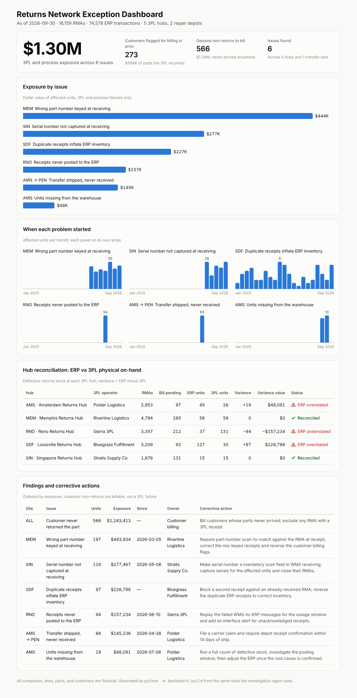

# RMA Reconciliation Agent

An AI agent that investigates service-parts returns (RMA) and inventory discrepancies across a 3PL and repair-depot network. It traces units through every handoff, finds root causes, quantifies financial exposure, separates 3PL failures from genuine customer non-returns, and drafts corrective actions for each 3PL.

**[View the live dashboard](https://kacy-mcnally.github.io/rma-reconciliation-agent/)**



## Why I built this

I spent 17 years in enterprise hardware service logistics, where a failed part has to be shipped, returned, received, repaired, and accounted for across companies, countries, and systems. When one handoff breaks, the physical part, the 3PL record, the ERP transaction, and the financial record stop telling the same story. Reconciling them by hand, across 212 locations, is how I recovered more than $8M in aging and disputed inventory.

This project builds that investigation into an agent. The failure patterns in the dataset are the ones I have seen in real returns networks: keying errors at receiving, missing serial numbers, duplicate receipts, interface outages, shipments lost in transit, warehouse shrink, and customers who never return a part.

## Results

On a synthetic network of about 16,000 RMAs and 75,000 ERP transactions, the detection engine finds all seven planted failure patterns with 100% recall and precision and no false alarms, in under a second.

| Site | Issue | Units | Exposure |
|---|---|---|---|
| Memphis | Wrong part number keyed at receiving (always an adjacent part number) since March 2026 | 197 | $443,934 |
| Singapore | Serial numbers not captured at receiving since May 2026 | 116 | $277,467 |
| Louisville | Duplicate receipts overstating ERP inventory | 97 | $226,788 |
| Reno | WMS-to-ERP interface outage, June 10 to 24, 2026 | 94 | $157,234 |
| Amsterdam to Penang | Transfer TO00169 shipped, never received | 66 | $145,236 |
| Amsterdam | Units missing from the warehouse while ERP shows them on hand | 19 | $48,091 |
| **Total 3PL and process failures** | | | **$1,298,750** |

It also separates 566 genuine customer non-returns ($1.24M, bill the customer) from 273 customers who are flagged for billing even though the 3PL received their part.

The detectors were written knowing which failure types occur in returns networks, so the score shows the method works end to end; it does not measure discovery of unknown problems.

## How it works

```
Synthetic ERP + 3PL data  ->  10 investigation tools  ->  MCP server  ->  Claude agent  ->  exception report
                                       |
                                       +-> scan + evaluate (no LLM)  ->  dashboard
```

| Component | Role |
|---|---|
| `data/generate.py` | Builds the SQLite dataset: 5 regional 3PL hubs, 2 repair depots, 210 parts, RMAs, WMS receipts, ERP transactions, and 3PL on-hand, with seven planted failures |
| `rma_agent/investigate.py` | Ten investigation tools: network overview, receipt mismatches, duplicate receipts, unposted receipts, in-transit gaps, on-hand variance attribution, missing warehouse units, customer non-returns, end-to-end RMA trace, and read-only SQL |
| `rma_agent/mcp_server.py` | Exposes the tools over the Model Context Protocol, so any MCP client can use them |
| `rma_agent/agent.py` | A Claude agent that connects to the MCP server, investigates, and writes an exception report with a corrective-action note for each 3PL |
| `rma_agent/scan.py` | Runs every detector without an LLM: the baseline and the input to scoring |
| `evaluate.py` | Scores findings against the planted answer key in `ground_truth/` |
| `dashboard/build.py` | Builds the self-contained exception dashboard |

## Quick start

```bash
pip install -r requirements.txt
python data/generate.py        # build the dataset
python -m rma_agent.scan       # deterministic scan, no API key needed
python evaluate.py             # score findings against the answer key
python -m dashboard.build      # exception dashboard -> dashboard/index.html
python -m rma_agent.agent      # Claude investigates (needs ANTHROPIC_API_KEY)
python -m rma_agent.agent "Why are customers at Memphis being billed for parts they returned?"
```

## Use the tools from Claude Desktop or Claude Code

```json
{
  "mcpServers": {
    "rma-reconciliation": {
      "command": "python",
      "args": ["-m", "rma_agent.mcp_server"],
      "cwd": "/path/to/rma-reconciliation-agent"
    }
  }
}
```

## Data

All companies, sites, parts, and customers are fictional. No data from any employer was used.

## Author

Kacy McNally, senior supply chain and service operations leader. Built with Claude Code as an engineering partner; the reconciliation logic and failure patterns come from my operations experience.
[LinkedIn](https://www.linkedin.com/in/kacy-mcnally/)
